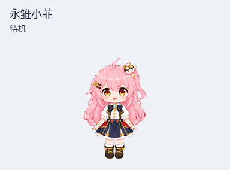
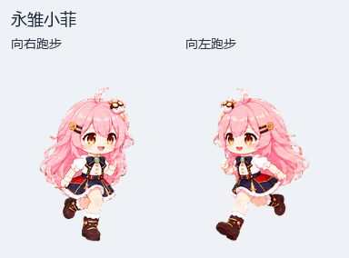

# 永雏小菲

粉色长发、琥珀色眼睛的永雏小菲，佩戴齿轮发夹与猫咪头饰，会挥手、跳跃、奔跑和转头。

九组动作、十六个转头方向的透明 v2 宠物图集，采用圆润清晰的动漫 Q 版风格。本版本包含修复后的左右跑步动作。

## 下载

- [完整素材包（v1.0.0）](https://github.com/asukua/yongchu-xiaofei-pet/releases/download/v1.0.0/yongchu-xiaofei-pet-v1.0.0.zip)
- [单独下载精灵图](https://github.com/asukua/yongchu-xiaofei-pet/releases/download/v1.0.0/spritesheet.png)
- [发布页与校验文件](https://github.com/asukua/yongchu-xiaofei-pet/releases/tag/v1.0.0)

## 使用

解压后选择 `spritesheet.png`，用于支持相同 v2 格式的宠物导入工具。也可将这张 PNG 附给 Pets 插件，说明：“把这张完整 v2 图集加入宠物库，命名为永雏小菲。”导入后的宠物记录属于各自账号。

`pet.json` 是素材说明清单，包含中文简介、图集尺寸、动作行和方向顺序；导入用的画面文件为 `spritesheet.png`。

## 左右跑步

摆臂与迈腿已重新校正。预览用统一每帧 100 毫秒展示跑步相位，实际播放速度由使用工具决定。衣摆遮挡、远侧摆臂幅度与部分循环接缝的短暂停留记录在[质量说明](docs/quality-notes.md)中。

## 格式与制作

- 1536 × 2288 像素，8 列 × 11 行，每格 192 × 208 像素。
- 73 个有效帧，15 个透明空格；九组动作及十六个顺时针转头方向。
- 最终图集通过结构、透明背景与质量检查，发布图像与保存到宠物库的画面一致。

[动作布局](docs/sprite-format.md) · [制作说明](docs/generation.md) · [检查结果](validation.json) · [SHA-256 校验](SHA256SUMS)

本项目为非官方 AI 生成的角色灵感宠物素材，由 ImageGen 绘制并整理。
